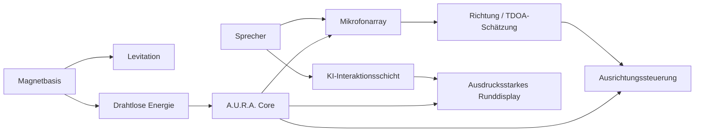
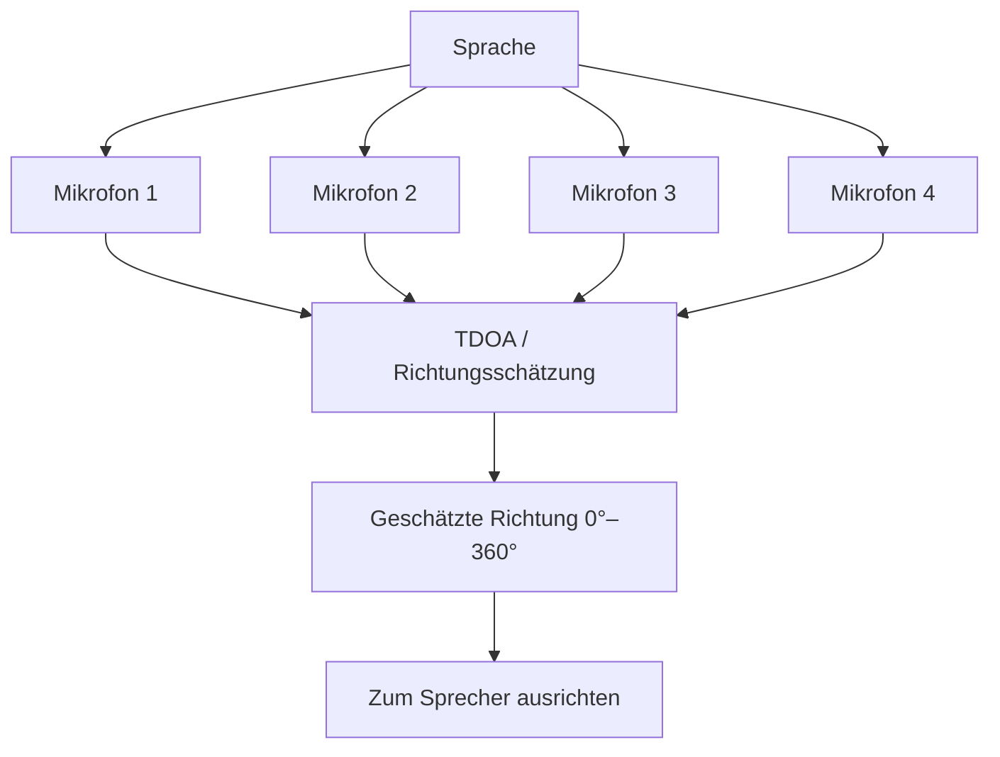

# A.U.R.A.

### Autonomous Universal Resonant Assistant

<a href="./README.md">English</a> · <a href="./README.de.md"><strong>Deutsch</strong></a> · <a href="./README.tr.md">Türkçe</a>

  
  
  

---

## Überblick

A.U.R.A. — **Autonomous Universal Resonant Assistant** — ist ein experimenteller physischer KI-Assistent, der konversationeller Intelligenz eine sichtbare, räumliche und ausdrucksstarke Präsenz geben soll.

Das Konzept verbindet Embedded Systems, richtungsabhängige Audioerfassung, magnetische Levitation, drahtlose Energieübertragung, Bewegungssteuerung und eine ausdrucksstarke runde Oberfläche in einer kompakten transparenten Kugelform.

## Physisches Konzept

- Transparenter kugelförmiger Kern mit etwa 12 cm Durchmesser
- Magnetische Levitation über einer speziellen Basis
- Kontaktlose drahtlose Energieübertragung
- Richtungsabhängige Audioerfassung mit mehreren Mikrofonen
- 360°-Ausrichtung zum aktiven Sprecher
- Rundes Display für ausdrucksstarke Augenanimationen
- KI-Interaktionsschicht verbunden mit Bewegung und visuellem Feedback

## Interaktionsablauf

## Richtungsabhängiges Audio

A.U.R.A. nutzt ein Multi-Mikrofon-Konzept, um die Richtung einer Stimme rund um das Gerät zu bestimmen. Relative Laufzeitunterschiede zwischen den Mikrofonen können zur Schätzung des Sprecherwinkels und zur Steuerung der physischen Ausrichtung verwendet werden.

## Kernsysteme

| System | Rolle |
|---|---|
| **Magnetische Levitation** | Den kugelförmigen Kern ohne sichtbare mechanische Stütze schweben lassen |
| **Wireless Power** | Energie kontaktlos von der Basis zur Kugel übertragen |
| **Mikrofonarray** | Richtungsinformationen rund um das Gerät erfassen |
| **Richtungsschätzung** | Sprecherwinkel aus Laufzeitunterschieden bestimmen |
| **Ausrichtungssteuerung** | Den Assistenten zum aktiven Sprecher drehen |
| **Ausdrucksstarkes Display** | Aufmerksamkeit und Systemzustand durch Augenanimationen vermitteln |
| **KI-Schicht** | Konversationelle Intelligenz mit physischer Interaktion verbinden |

## Engineering-Fokus

A.U.R.A. verbindet Software- und Hardwarethemen, die üblicherweise getrennt entwickelt werden:

- Embedded Systems
- Audiosignalverarbeitung
- Human-Computer Interaction
- Sensor Fusion
- Bewegungssteuerung
- Wireless Power
- Physisches Prototyping
- KI-Integration
- Echtzeit-State-Koordination
- Produktorientiertes Industriedesign

## Projektcharakter

A.U.R.A. ist ein experimentelles Prototypkonzept. Das Repository beschreibt Systemarchitektur und Interaktionsdesign, ohne die Hardware als fertiges kommerzielles Produkt darzustellen.

---

### Entwickelt von [Taha Kubilay](https://github.com/tahakubilay)

`Physical AI` · `Embedded Systems` · `IoT` · `Audio Processing` · `Human-Computer Interaction`

