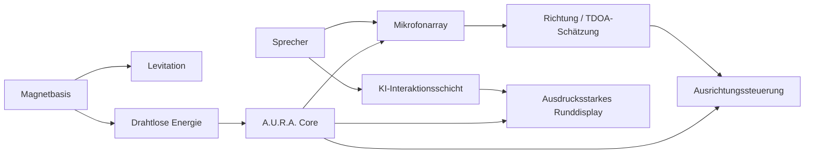
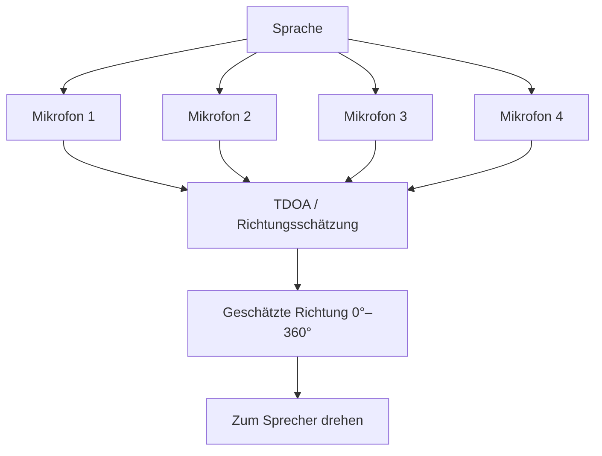

<div align="center">

# A.U.R.A.

### Autonomous Universal Resonant Assistant


<p><a href="./README.md">English</a> · <a href="./README.de.md"><strong>Deutsch</strong></a> · <a href="./README.tr.md">Türkçe</a></p>

<p>
<a href="https://github.com/tahakubilay"></a>
<a href="https://github.com/tahakubilay/Aura"></a>


</p>

</div>

---

## ✨ Auf einen Blick

| | |
|---|---|
| 🤖 **Konzept** | Physischer KI-Assistent mit ausdrucksstarker Präsenz |
| 🔮 **Form** | Transparenter kugelförmiger Kern, ca. 12 cm Durchmesser |
| 🧲 **Levitation** | Magnetisch über einer speziellen Basis schwebend |
| ⚡ **Energie** | Kontaktlose drahtlose Energieübertragung |
| 🎙️ **Wahrnehmung** | Richtungsabhängige Audioerfassung mit mehreren Mikrofonen |
| 🔄 **Interaktion** | 360°-Ausrichtung zum Sprecher |
| 👀 **Ausdruck** | Rundes Display mit animierten Augen |

> [!NOTE]
> A.U.R.A. ist ein experimentelles **Hardware- und Software-Prototypkonzept**. Detaillierte Elektronik, BOM, Steuerungsarchitektur und Fertigungsnotizen werden nach Finalisierung des Prototypdesigns dokumentiert.

## 🔎 Überblick

A.U.R.A. — **Autonomous Universal Resonant Assistant** — ist ein Konzept für einen kompakten physischen KI-Kern, der eher wie eine Präsenz als wie ein klassischer Smart Speaker wirken soll.

Das Konzept kombiniert mehrere Disziplinen:

- KI-Interaktion
- Embedded Systems
- Richtungsabhängige Audioerfassung
- Magnetische Levitation
- Drahtlose Energieübertragung
- Bewegungssteuerung
- Ausdrucksstarkes visuelles Feedback
- Industrie- und Interaktionsdesign

Das Ziel ist ein transparenter kugelförmiger Assistent, der scheinbar schwebt, sich zur sprechenden Person ausrichtet und über animierte Augen visuell reagiert.

## 💡 Das Konzept

```text
Stimme
  ↓
Richtungsabhängige Audioerfassung
  ↓
Schätzung des Sprecherwinkels
  ↓
Physische Ausrichtung
  ↓
KI-Interaktion
  ↓
Ausdrucksstarke visuelle Reaktion
```

A.U.R.A. soll KI-Interaktion **räumlich, physisch und ausdrucksstark** machen statt rein bildschirmbasiert.

## 🏗️ High-Level-Systemfluss



## ⚙️ Kernelemente des Designs

| System | Konzept |
|---|---|
| 🧲 **Magnetische Levitation** | Transparenter Kern schwebt ohne sichtbare mechanische Stütze |
| ⚡ **Wireless Power** | Induktive Energieübertragung von der Basis zum schwebenden Kern |
| 🎙️ **Mikrofonarray** | Mehrere Mikrofone rund um die Kugel |
| 🧭 **Direction of Arrival** | Sprecherichtung aus relativen Ankunftszeiten bestimmen |
| 🔄 **360°-Ausrichtung** | Den Assistenten zum aktiven Sprecher drehen |
| 👀 **Ausdrucksstarkes Display** | Rundes Display für Augenanimationen und Zustandsfeedback |
| 🤖 **KI-Schicht** | Konversationsintelligenz mit physischer Interaktion verbinden |
| 🧱 **Produktdesign** | Kompakter, sauberer Prototyp statt Laboraufbau |

## 🎙️ Richtungsabhängige Interaktion

Eine der Kernideen ist, dass A.U.R.A. versteht, **woher** eine Stimme kommt.

Auf hoher Ebene werden mehrere Mikrofone und Laufzeitunterschiede der Audiosignale genutzt, um einen Winkel rund um das Gerät zu bestimmen.



Die konkrete Signalverarbeitung, Kalibrierung und Motorsteuerung wird aus dem finalisierten Prototyp dokumentiert.

## ⚡ Kontaktlose Energie & Levitation

Das physische Konzept verbindet zwei Ideen gleichzeitig:

**Levitation** — der transparente Kern bleibt über der Basis schwebend.

**Drahtlose Energie** — der Kern erhält Energie ohne sichtbares Kabel zwischen Basis und Kugel.

So bleibt die visuelle Illusion eines eigenständigen schwebenden KI-Kerns erhalten.

## 👀 Ausdrucksstarke Oberfläche

Anstelle eines rechteckigen Displays ist ein **rundes visuelles Interface** mit ausdrucksstarken Augen vorgesehen.

Mögliche Zustände:

- Zuhören
- Nachdenken
- Sprechen
- Neugierig / aufmerksam
- Idle
- Benachrichtigung / Alarm
- Fehler / Verbindungszustand

## 🧠 Engineering-Fokus

A.U.R.A. verbindet Software- und Hardwareprobleme, die meist getrennt auftreten:

- Embedded Control
- Audiosignalverarbeitung
- Human-Computer Interaction
- Sensor Fusion
- Bewegungssteuerung
- Wireless Power
- Physisches Prototyping
- KI-Integration
- Echtzeit-State-Koordination
- Produktorientiertes Industriedesign

## 🖼️ Prototyp-Visuals

Konzept-Renderings, mechanische Ansichten, internes Komponentenlayout und Prototypfotos werden später ergänzt.

| Außenansicht | Internes Layout | Interaktion |
|---|---|---|
| 🔮 Demnächst | ⚙️ Demnächst | 👀 Demnächst |

## 📐 Geplante Dokumentation

- Vollständige Systemarchitektur
- Hardware-Blockdiagramm
- Bill of Materials
- Mechanische Abmessungen
- Levitation
- Wireless-Power-Architektur
- Geometrie des Mikrofonarrays
- DoA-/TDOA-Verarbeitung
- Bewegungssteuerung
- Display-/Animationssubsystem
- KI-Kommunikationsschicht
- Power Budget
- Montageprozess
- Kalibrierung
- Firmware-/Software-Setup

## 🛣️ Projektstatus

- [x] Produktkonzept
- [x] Interaktionskonzept
- [x] High-Level-Systemarchitektur
- [x] Richtungsabhängiges Audiokonzept
- [ ] Finale Hardwareplattform wählen
- [ ] Finale Komponenten wählen
- [ ] Mechanisches Design
- [ ] Elektronikprototyp
- [ ] Levitation + WPT integrieren
- [ ] Mikrofonarray kalibrieren
- [ ] Bewegungssteuerung prototypisieren
- [ ] Expressive UI implementieren
- [ ] Vollständige KI-Integration
- [ ] Prototypvisuals und Demo-Video

## 💡 Warum dieses Projekt wichtig ist

A.U.R.A. versucht, KI aus dem Browserfenster und vom Smartphonebildschirm herauszubringen.

Es untersucht, was passiert, wenn konversationelle Intelligenz **physische Präsenz, räumliches Bewusstsein, Bewegung und Ausdruck** erhält.

`Physical AI` · `Embedded Systems` · `IoT` · `Audio Processing` · `Human-Computer Interaction` · `Hardware Prototyping`

---

<div align="center">

### Entwickelt von [Taha Kubilay](https://github.com/tahakubilay)

</div>