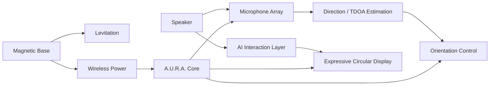
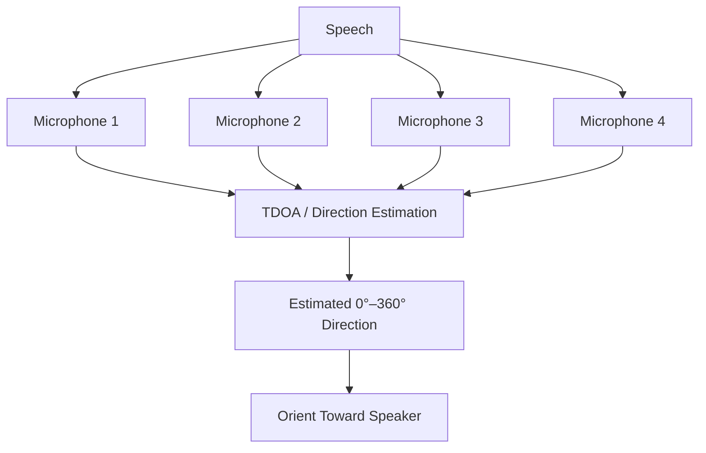

# A.U.R.A.

### Autonomous Universal Resonant Assistant

<a href="./README.md"><strong>English</strong></a> · <a href="./README.de.md">Deutsch</a> · <a href="./README.tr.md">Türkçe</a>

  
  
  

---

## Overview

A.U.R.A. — **Autonomous Universal Resonant Assistant** — is an experimental physical AI assistant designed to give conversational intelligence a visible, spatial and expressive presence.

The concept combines embedded systems, directional audio sensing, magnetic levitation, wireless power, motion control and an expressive circular interface inside a compact transparent spherical form.

## Physical Concept

- Approximately 12 cm transparent spherical core
- Magnetic levitation above a dedicated base
- Contactless wireless power transfer
- Multi-microphone directional audio sensing
- 360° orientation toward the active speaker
- Circular display for expressive eye animations
- AI interaction layer connected to physical motion and visual feedback

## Interaction Flow

## Directional Audio

A.U.R.A. uses a multi-microphone concept to estimate where a voice originates around the device. Relative arrival-time differences between microphones can be used to estimate the speaker direction and drive physical orientation.

## Core Systems

| System | Role |
|---|---|
| **Magnetic Levitation** | Suspend the spherical core without visible mechanical support |
| **Wireless Power** | Deliver energy from the base without a physical cable to the sphere |
| **Microphone Array** | Capture directional audio around the device |
| **Direction Estimation** | Estimate speaker angle using timing differences |
| **Orientation Control** | Rotate the assistant toward the active speaker |
| **Expressive Display** | Communicate attention and system state through animated eyes |
| **AI Layer** | Connect conversational intelligence to physical interaction |

## Engineering Focus

A.U.R.A. combines software and hardware concerns that are usually developed separately:

- Embedded systems
- Audio signal processing
- Human-computer interaction
- Sensor fusion
- Motion control
- Wireless power
- Physical prototyping
- AI integration
- Real-time state coordination
- Product-oriented industrial design

## Project Nature

A.U.R.A. is an experimental prototype concept. The repository presents the system architecture and interaction design without representing the hardware as a finished commercial product.

---

### Built by [Taha Kubilay](https://github.com/tahakubilay)

`Physical AI` · `Embedded Systems` · `IoT` · `Audio Processing` · `Human-Computer Interaction`

