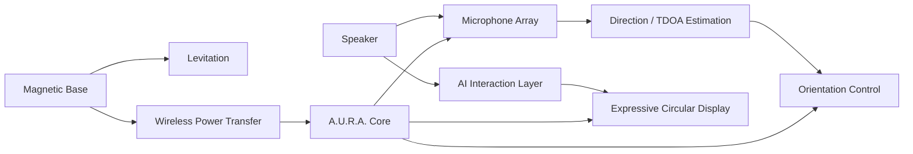
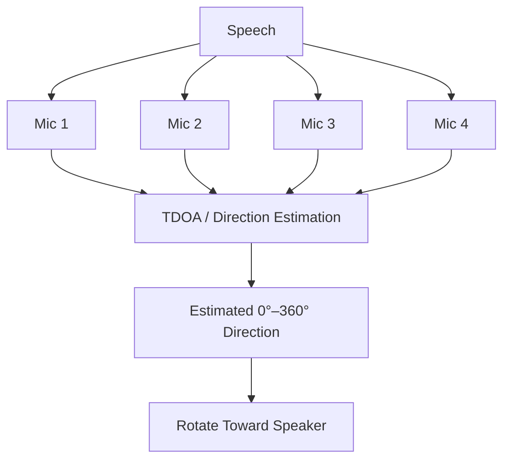

<div align="center">

# A.U.R.A.

### Autonomous Universal Resonant Assistant

<a href="https://github.com/tahakubilay/Aura">
  
</a>

<br/>

[](https://github.com/tahakubilay)
[](https://github.com/tahakubilay/Aura)
[](#-overview)
[](#-project-status)

<br/>


</div>

---

## ✨ At a Glance

| | |
|---|---|
| 🤖 **Concept** | Physical AI assistant with an expressive presence |
| 🔮 **Form** | Transparent spherical core, approximately 12 cm in diameter |
| 🧲 **Levitation** | Magnetically suspended above a dedicated base |
| ⚡ **Power** | Contactless wireless power transfer |
| 🎙️ **Perception** | Multi-microphone directional audio sensing |
| 🔄 **Interaction** | 360° orientation toward the speaker |
| 👀 **Expression** | Circular display with animated eye expressions |

> [!NOTE]
> A.U.R.A. is an experimental **hardware + software prototype concept**. Detailed electronics, BOM, control architecture and manufacturing notes will be documented after the prototype design is finalized.

## 🧭 Quick Navigation

[Overview](#-overview) • [Concept](#-the-concept) • [System Flow](#-high-level-system-flow) • [Core Ideas](#-core-design-elements) • [Roadmap](#-project-status)

## 🔎 Overview

A.U.R.A. — **Autonomous Universal Resonant Assistant** — is a concept for a compact physical AI core that is intended to feel more like a presence than a traditional smart speaker.

The idea combines several disciplines:

- AI interaction
- Embedded systems
- Directional audio sensing
- Magnetic levitation
- Wireless power transfer
- Motion control
- Expressive visual feedback
- Industrial / interaction design

The result is envisioned as a transparent spherical assistant that appears to float, turns toward the person speaking and responds visually through expressive animated eyes.

## 💡 The Concept

```text
Voice
  ↓
Directional Audio Sensing
  ↓
Speaker Angle Estimation
  ↓
Physical Orientation
  ↓
AI Interaction
  ↓
Expressive Visual Response
```

A.U.R.A. is intended to make AI interaction feel **spatial, physical and expressive** instead of purely screen-based.

## 🏗️ High-Level System Flow



## ⚙️ Core Design Elements

| System | Concept |
|---|---|
| 🧲 **Magnetic Levitation** | Transparent core suspended above a matte base without physical support |
| ⚡ **Wireless Power** | Inductive power transfer from the base to the floating core |
| 🎙️ **Microphone Array** | Multiple microphones positioned around the sphere |
| 🧭 **Direction of Arrival** | Estimate speaker direction using relative audio arrival timing |
| 🔄 **360° Orientation** | Turn the assistant toward the active speaker |
| 👀 **Expressive Display** | Circular screen used for animated eye expressions and visual feedback |
| 🤖 **AI Layer** | Conversational intelligence connected to the physical interaction system |
| 🧱 **Product Design** | Compact, clean prototype intended to look like a finished object rather than a bench experiment |

## 🎙️ Directional Interaction

One of the central ideas behind A.U.R.A. is that the assistant should understand **where** a voice is coming from.

At a high level, the concept uses multiple microphones and timing differences between received audio signals to estimate an azimuth around the device.



The exact signal-processing implementation, calibration method and motor-control strategy will be documented from the finalized prototype.

## ⚡ Contactless Power & Levitation

The physical concept is designed around two ideas happening at the same time:

**Levitation** — the transparent core remains suspended above the base.

**Wireless power** — the core receives operating power without a physical cable between the base and sphere.

This allows the device to preserve the visual illusion of a self-contained floating AI core.

## 👀 Expressive Interface

Instead of using a conventional rectangular display, A.U.R.A. is envisioned with a **circular visual interface** centered around expressive eyes.

Possible interaction states include:

- Listening
- Thinking
- Speaking
- Curious / attentive
- Idle
- Notification / alert
- Error / connection state

The goal is not merely decoration; expression is intended to provide an intuitive visual indication of the system's state.

## 🧠 Engineering Focus

A.U.R.A. brings together software and hardware problems that usually live in separate projects:

- Embedded control
- Audio signal processing
- Human-computer interaction
- Sensor fusion
- Motion control
- Wireless power
- Physical prototyping
- AI integration
- Real-time state coordination
- Product-oriented industrial design

## 🖼️ Prototype Visuals

Concept renders, mechanical views, internal component layout and prototype photography will be added here later.

| Exterior Concept | Internal Layout | Interaction |
|---|---|---|
| 🔮 Coming soon | ⚙️ Coming soon | 👀 Coming soon |

A short prototype / animation GIF can be added once the visual design is finalized.

## 📐 Planned Documentation

The finalized project documentation is expected to cover:

- Full system architecture
- Hardware block diagram
- Bill of materials
- Mechanical dimensions
- Levitation system
- Wireless power architecture
- Microphone-array geometry
- DoA / TDOA processing
- Motion-control system
- Display / animation subsystem
- AI communication layer
- Power budget
- Assembly process
- Calibration
- Firmware / software setup

## 🛣️ Project Status

- [x] Product concept
- [x] Interaction concept
- [x] High-level system architecture
- [x] Directional audio concept
- [ ] Final hardware platform selection
- [ ] Final component selection
- [ ] Mechanical design
- [ ] Electronics prototype
- [ ] Levitation + WPT integration
- [ ] Microphone-array calibration
- [ ] Motion-control prototype
- [ ] Expressive UI implementation
- [ ] Full AI integration
- [ ] Prototype visuals and demo video

## 💡 Why This Project Matters

A.U.R.A. represents an attempt to move AI beyond a browser window or phone screen.

It explores what happens when conversational intelligence gains:

**physical presence, spatial awareness, movement and expression.**

From a portfolio perspective, it connects:

`Physical AI` · `Embedded Systems` · `IoT` · `Audio Processing` · `Human-Computer Interaction` · `Hardware Prototyping`

---

<div align="center">

### Built by [Taha Kubilay](https://github.com/tahakubilay)

**Software Engineer · AI Systems · Embedded / Physical Computing · Product Engineering**

[⬆ Back to top](#aura)

</div>