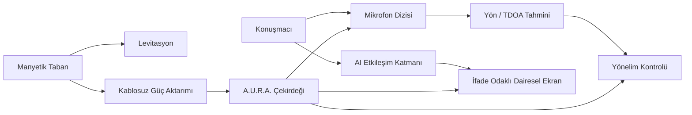
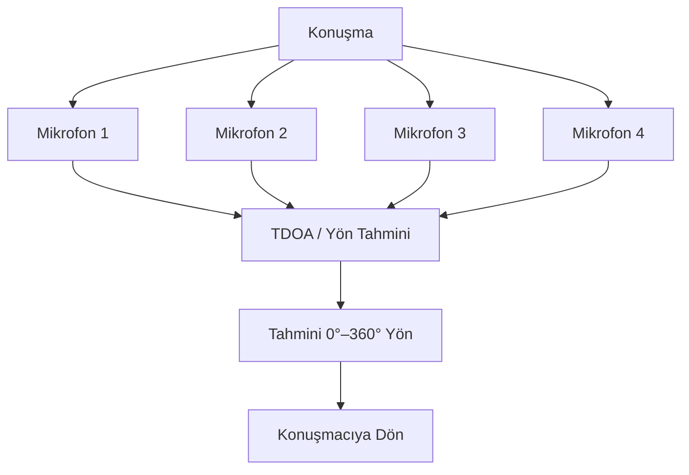

<div align="center">

# A.U.R.A.

### Autonomous Universal Resonant Assistant


<p><a href="./README.md">English</a> · <a href="./README.de.md">Deutsch</a> · <a href="./README.tr.md"><strong>Türkçe</strong></a></p>

<p>
<a href="https://github.com/tahakubilay"></a>
<a href="https://github.com/tahakubilay/Aura"></a>


</p>

</div>

---

## ✨ Kısaca

| | |
|---|---|
| 🤖 **Konsept** | İfade sahibi fiziksel AI asistanı |
| 🔮 **Form** | Yaklaşık 12 cm çapında şeffaf küresel çekirdek |
| 🧲 **Levitasyon** | Özel taban üzerinde manyetik olarak havada asılı |
| ⚡ **Güç** | Temassız kablosuz güç aktarımı |
| 🎙️ **Algılama** | Çoklu mikrofonla yönsel ses algılama |
| 🔄 **Etkileşim** | Konuşmacıya doğru 360° yönelim |
| 👀 **İfade** | Animasyonlu göz ifadeleri gösteren dairesel ekran |

> [!NOTE]
> A.U.R.A. deneysel bir **donanım + yazılım prototip konseptidir**. Elektronik detaylar, BOM, kontrol mimarisi ve üretim notları prototip tasarımı finalize edildikten sonra belgelenecektir.

## 🔎 Genel Bakış

A.U.R.A. — **Autonomous Universal Resonant Assistant** — klasik bir akıllı hoparlörden çok fiziksel bir varlık hissi vermesi amaçlanan kompakt bir fiziksel AI çekirdeği konseptidir.

Fikir birden fazla disiplini bir araya getirir:

- AI etkileşimi
- Embedded systems
- Yönsel ses algılama
- Manyetik levitasyon
- Kablosuz güç aktarımı
- Hareket kontrolü
- İfade odaklı görsel geri bildirim
- Endüstriyel / etkileşim tasarımı

Ortaya çıkması hedeflenen ürün; havada süzülüyormuş gibi görünen, konuşan kişiye dönen ve animasyonlu göz ifadeleriyle görsel tepki veren şeffaf küresel bir asistandır.

## 💡 Konsept

```text
Ses
  ↓
Yönsel Ses Algılama
  ↓
Konuşmacı Açısı Tahmini
  ↓
Fiziksel Yönelim
  ↓
AI Etkileşimi
  ↓
İfade Odaklı Görsel Tepki
```

A.U.R.A., AI etkileşimini yalnızca ekran tabanlı olmaktan çıkarıp **mekânsal, fiziksel ve ifade sahibi** hale getirmeyi amaçlar.

## 🏗️ Yüksek Seviye Sistem Akışı



## ⚙️ Temel Tasarım Bileşenleri

| Sistem | Konsept |
|---|---|
| 🧲 **Manyetik Levitasyon** | Şeffaf çekirdek fiziksel destek olmadan mat taban üzerinde süzülür |
| ⚡ **Kablosuz Güç** | Taban ile küre arasında indüktif güç aktarımı |
| 🎙️ **Mikrofon Dizisi** | Kürenin çevresine yerleştirilen çoklu mikrofonlar |
| 🧭 **Direction of Arrival** | Ses varış zamanlarındaki farklarla konuşmacı yönünü tahmin etmek |
| 🔄 **360° Yönelim** | Asistanı aktif konuşmacıya döndürmek |
| 👀 **İfade Odaklı Ekran** | Göz animasyonları ve görsel durum geri bildirimi |
| 🤖 **AI Katmanı** | Konuşma zekâsını fiziksel etkileşim sistemiyle bağlamak |
| 🧱 **Ürün Tasarımı** | Bench prototipi gibi değil, bitmiş ürün gibi görünen kompakt yapı |

## 🎙️ Yönsel Etkileşim

A.U.R.A.'nın temel fikirlerinden biri asistanın sesin **nereden** geldiğini anlayabilmesidir.

Yüksek seviyede sistem, çoklu mikrofonlar ve ses sinyallerinin varış zamanlarındaki farkları kullanarak cihaz çevresindeki azimut açısını tahmin eder.



Kesin sinyal işleme implementasyonu, kalibrasyon yöntemi ve motor kontrol stratejisi final prototip üzerinden belgelenecektir.

## ⚡ Temassız Güç & Levitasyon

Fiziksel konsept aynı anda iki fikre dayanır:

**Levitasyon** — şeffaf çekirdek tabanın üzerinde havada asılı kalır.

**Kablosuz güç** — çekirdek, taban ile küre arasında fiziksel kablo olmadan enerji alır.

Bu sayede kendi kendine yeten, süzülen bir AI çekirdeği illüzyonu korunur.

## 👀 İfade Odaklı Arayüz

Klasik dikdörtgen ekran yerine, A.U.R.A. ifade sahibi gözlerin merkezde olduğu **dairesel bir görsel arayüz** ile tasarlanır.

Olası durumlar:

- Dinliyor
- Düşünüyor
- Konuşuyor
- Meraklı / dikkatli
- Beklemede
- Bildirim / uyarı
- Hata / bağlantı durumu

Amaç yalnızca dekorasyon değil; ifade, sistem durumunu sezgisel biçimde anlatan bir UX katmanıdır.

## 🧠 Mühendislik Odağı

A.U.R.A. normalde ayrı projelerde yaşayan yazılım ve donanım problemlerini bir araya getirir:

- Embedded kontrol
- Ses sinyal işleme
- Human-computer interaction
- Sensor fusion
- Hareket kontrolü
- Wireless power
- Fiziksel prototipleme
- AI entegrasyonu
- Gerçek zamanlı state koordinasyonu
- Ürün odaklı endüstriyel tasarım

## 🖼️ Prototip Görselleri

Konsept render'ları, mekanik görünümler, iç bileşen yerleşimi ve prototip fotoğrafları daha sonra eklenecek.

| Dış Konsept | İç Yerleşim | Etkileşim |
|---|---|---|
| 🔮 Yakında | ⚙️ Yakında | 👀 Yakında |

## 📐 Planlanan Dokümantasyon

- Tam sistem mimarisi
- Donanım blok diyagramı
- Malzeme listesi
- Mekanik ölçüler
- Levitasyon sistemi
- Kablosuz güç mimarisi
- Mikrofon dizisi geometrisi
- DoA / TDOA işleme
- Hareket kontrol sistemi
- Ekran / animasyon alt sistemi
- AI iletişim katmanı
- Güç bütçesi
- Montaj süreci
- Kalibrasyon
- Firmware / yazılım kurulumu

## 🛣️ Proje Durumu

- [x] Ürün konsepti
- [x] Etkileşim konsepti
- [x] Yüksek seviye sistem mimarisi
- [x] Yönsel ses konsepti
- [ ] Final donanım platformunu seç
- [ ] Final bileşenleri seç
- [ ] Mekanik tasarım
- [ ] Elektronik prototip
- [ ] Levitasyon + WPT entegrasyonu
- [ ] Mikrofon dizisi kalibrasyonu
- [ ] Hareket kontrol prototipi
- [ ] İfade odaklı UI implementasyonu
- [ ] Tam AI entegrasyonu
- [ ] Prototip görselleri ve demo videosu

## 💡 Bu Proje Neden Önemli?

A.U.R.A., AI'ı tarayıcı penceresi veya telefon ekranının ötesine taşımaya yönelik bir denemedir.

Konuşma zekâsının **fiziksel varlık, mekânsal farkındalık, hareket ve ifade** kazandığında nasıl bir etkileşim doğuracağını araştırır.

`Physical AI` · `Embedded Systems` · `IoT` · `Audio Processing` · `Human-Computer Interaction` · `Hardware Prototyping`

---

<div align="center">

### Geliştiren: [Taha Kubilay](https://github.com/tahakubilay)

</div>