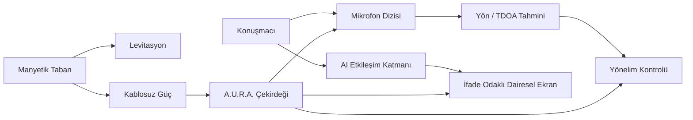
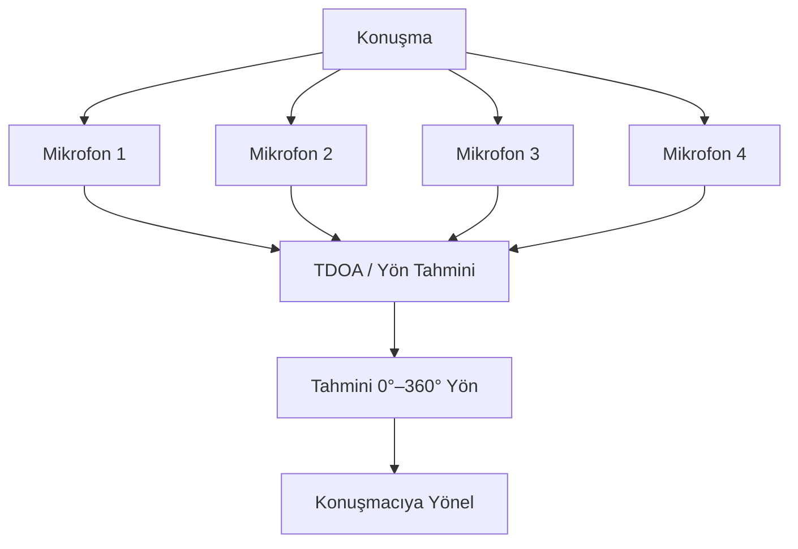

# A.U.R.A.

### Autonomous Universal Resonant Assistant

<a href="./README.md">English</a> · <a href="./README.de.md">Deutsch</a> · <a href="./README.tr.md"><strong>Türkçe</strong></a>

  
  
  

---

## Genel Bakış

A.U.R.A. — **Autonomous Universal Resonant Assistant** — konuşma zekâsına görünür, mekânsal ve ifade sahibi bir fiziksel varlık kazandırmayı amaçlayan deneysel bir fiziksel AI asistanıdır.

Konsept; embedded systems, yönsel ses algılama, manyetik levitasyon, kablosuz güç aktarımı, hareket kontrolü ve ifade odaklı dairesel arayüzü kompakt şeffaf küresel bir form içinde birleştirir.

## Fiziksel Konsept

- Yaklaşık 12 cm çapında şeffaf küresel çekirdek
- Özel taban üzerinde manyetik levitasyon
- Temassız kablosuz güç aktarımı
- Çoklu mikrofonla yönsel ses algılama
- Aktif konuşmacıya doğru 360° yönelim
- İfade odaklı göz animasyonları için dairesel ekran
- Fiziksel hareket ve görsel geri bildirimle bağlantılı AI katmanı

## Etkileşim Akışı

## Yönsel Ses

A.U.R.A., cihaz çevresinde bir sesin hangi yönden geldiğini tahmin etmek için çoklu mikrofon yaklaşımını kullanır. Mikrofonlar arasındaki göreli varış zamanı farkları konuşmacı açısını hesaplamak ve fiziksel yönelimi kontrol etmek için kullanılabilir.

## Temel Sistemler

| Sistem | Rol |
|---|---|
| **Manyetik Levitasyon** | Küresel çekirdeği görünür mekanik destek olmadan havada tutmak |
| **Kablosuz Güç** | Enerjiyi tabandan küreye fiziksel kablo olmadan aktarmak |
| **Mikrofon Dizisi** | Cihaz çevresinden yönsel ses bilgisi toplamak |
| **Yön Tahmini** | Varış zamanı farklarından konuşmacı açısını hesaplamak |
| **Yönelim Kontrolü** | Asistanı aktif konuşmacıya çevirmek |
| **İfade Odaklı Ekran** | Dikkat ve sistem durumunu göz animasyonlarıyla ifade etmek |
| **AI Katmanı** | Konuşma zekâsını fiziksel etkileşimle birleştirmek |

## Mühendislik Odağı

A.U.R.A., normalde ayrı geliştirilen yazılım ve donanım problemlerini tek projede birleştirir:

- Embedded systems
- Ses sinyal işleme
- Human-computer interaction
- Sensor fusion
- Hareket kontrolü
- Wireless power
- Fiziksel prototipleme
- AI entegrasyonu
- Gerçek zamanlı state koordinasyonu
- Ürün odaklı endüstriyel tasarım

## Projenin Niteliği

A.U.R.A. deneysel bir prototip konseptidir. Repository, donanımı tamamlanmış ticari ürün gibi sunmak yerine sistem mimarisini ve etkileşim tasarımını açıklar.

---

### Geliştiren: [Taha Kubilay](https://github.com/tahakubilay)

`Physical AI` · `Embedded Systems` · `IoT` · `Audio Processing` · `Human-Computer Interaction`

